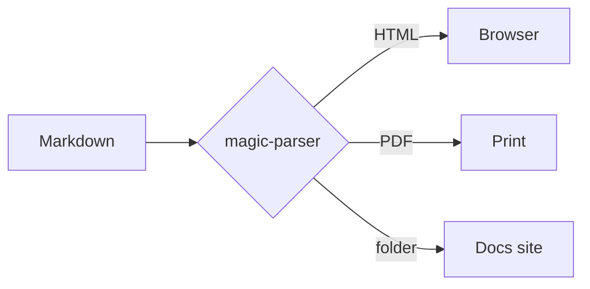
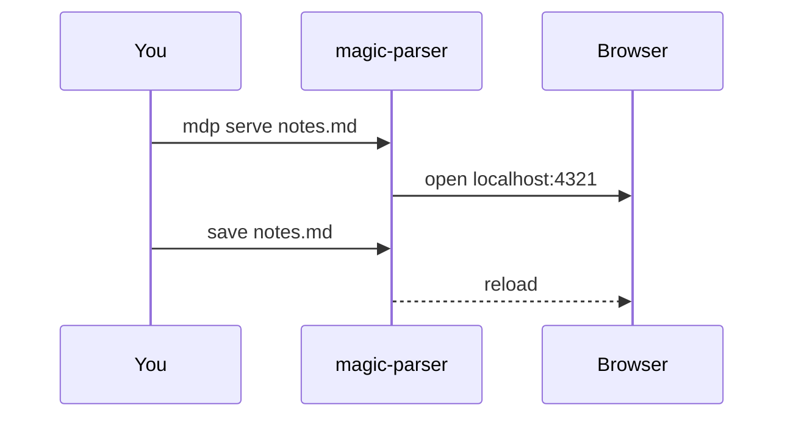
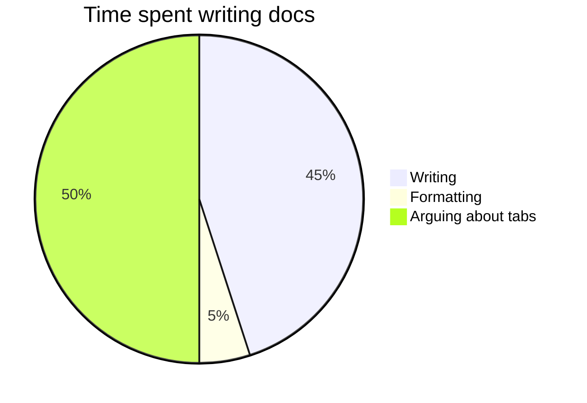

# Diagrams

Fenced `mermaid` blocks become diagrams. Mermaid is loaded from a CDN only on pages that have one, and diagrams redraw to match when you switch between light and dark.

## Flowchart

````markdown

````


## Sequence diagram



## Pie chart


