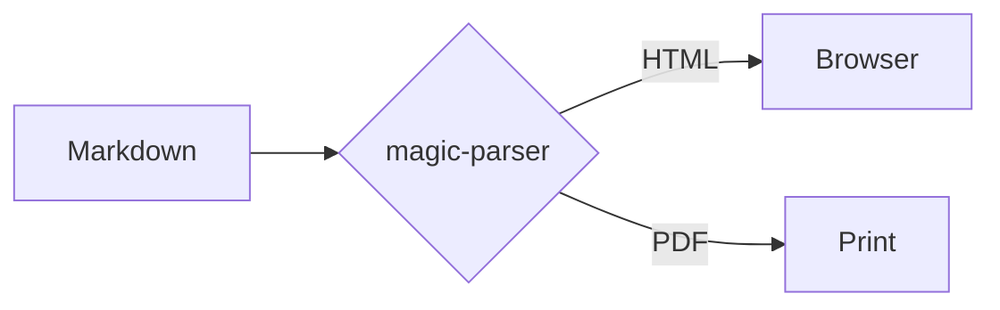
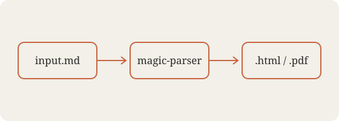

# Magic Parser Showcase

A tour of everything **magic-parser** can render, from plain paragraphs to math, diagrams and inline HTML. Toggle dark mode with the button in the top-right corner.

## Text formatting

Plain paragraphs flow naturally, with *italics*, **bold**, ***both***, ~~strikethrough~~, ==highlighted text==, ++inserted text++, `inline code`, H~2~O subscripts and E = mc^2^ superscripts. Typographic niceties are automatic: "smart quotes", 'single quotes', en–dashes -- and em—dashes ---, and ellipses...

Bare URLs like https://commonmark.org become links, as do [inline links](https://github.com "GitHub") and [reference links][ref]. Emoji shortcodes work too :sparkles: :rocket: :tada:.

Press <kbd>Cmd</kbd> + <kbd>K</kbd> to open the palette. The HTML spec is maintained by the W3C.

*[HTML]: HyperText Markup Language
*[W3C]: World Wide Web Consortium

[ref]: https://spec.commonmark.org/

## Headings

### Third level
#### Fourth level
##### Fifth level
###### Sixth level

## Lists

- Unordered item
- Another item
  - Nested item
    - Deeper still
- Back to the top

1. First step
2. Second step
   1. Sub-step a
   2. Sub-step b
3. Third step

### Task lists

- [x] Parse Markdown
- [x] Support every modern extension
- [ ] Take over the world
  - [x] Nested done task
  - [ ] Nested open task

### Definition lists

Markdown
: A lightweight markup language for creating formatted text.

KaTeX
: A fast math typesetting library for the web.

## Blockquotes

> The best way to predict the future is to invent it.
>
> — Alan Kay

> Nested quotes work as well:
> > This is a quote inside a quote.

## Callouts

> [!NOTE]
> GitHub-style alerts are supported: `NOTE`, `TIP`, `IMPORTANT`, `WARNING` and `CAUTION`.

> [!TIP]
> Put a `mdp.config.yaml` next to your files to share settings.

> [!WARNING]
> PDF output needs Chrome, Chromium, Edge or Brave installed.

::: important Container syntax
Fenced `:::` containers work too: `note`, `tip`, `info`, `important`, `warning`, `caution`, `danger`, `success`.
:::

::: details Click to expand
Hidden content lives here, including **formatting** and `code`.
:::

## Code

Inline `const x = 42;` and fenced blocks with syntax highlighting:

```js
// Render a markdown file
import { loadDocument, renderDocument } from './src/render.js';

const doc = loadDocument('README.md', { cli: { page: { style: 'grid' } } });
const { html } = renderDocument(doc, { imageMode: 'embed', outDir: '.' });
console.log(`Rendered ${html.length} bytes`);
```

```python
from dataclasses import dataclass

@dataclass
class Page:
    style: str = "grid"
    mode: str = "light"

    def describe(self) -> str:
        return f"{self.style} page in {self.mode} mode"  # f-string
```

```bash
mdp build notes.md --style lined --mode dark -o notes.html
```

```diff
- page: plain
+ page: grid
```

```
A plain block with no language.
```

## Tables

| Feature        | Syntax              | Supported |
| :------------- | :------------------ | --------: |
| Tables         | `\| a \| b \|`      |       Yes |
| Task lists     | `- [x] done`        |       Yes |
| Math           | `$e^{i\pi} + 1 = 0$`|       Yes |
| Footnotes      | `[^1]`              |       Yes |

## Math

Inline math like $e^{i\pi} + 1 = 0$ and $\sum_{k=1}^{n} k = \frac{n(n+1)}{2}$ sits within a sentence. Display math gets its own line:

$$
\int_{-\infty}^{\infty} e^{-x^2}\,dx = \sqrt{\pi}
$$

$$
\mathbf{A} = \begin{bmatrix} a_{11} & a_{12} \\ a_{21} & a_{22} \end{bmatrix},
\qquad
f(x) = \begin{cases} x^2 & x \ge 0 \\ -x & x < 0 \end{cases}
$$

## Diagrams



## Images



## Footnotes

Here is a sentence with a footnote.[^1] And another one.[^note]

[^1]: Footnotes are collected at the end of the document.
[^note]: They can have **formatting** and multiple words as labels.

## Inline HTML

<div align="center">
  <p>Raw <strong>HTML</strong> passes through, e.g. <sup>sup</sup>, <sub>sub</sub>, <abbr title="abbreviation">abbr</abbr>.</p>
</div>

<details>
<summary>Native HTML &lt;details&gt;</summary>

Markdown *inside* HTML blocks works when separated by blank lines.

</details>

---

*Made with magic-parser.*
